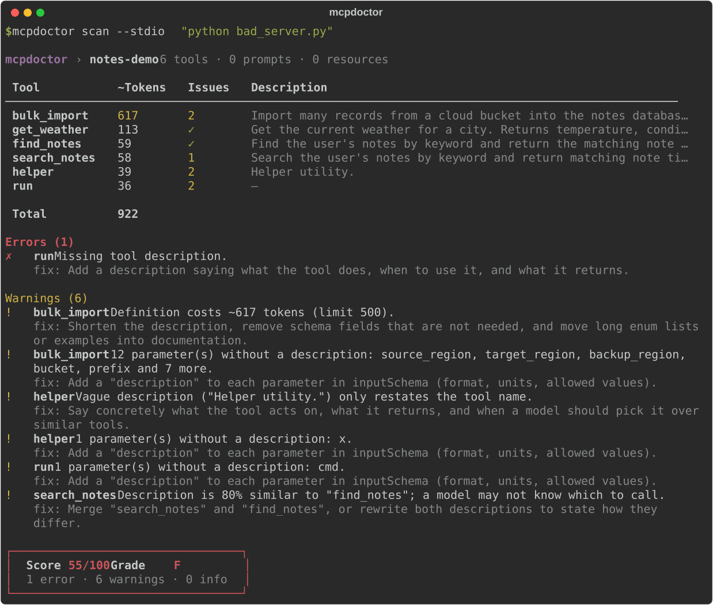

<h1 align="center">mcp-doctor</h1>

<p align="center">
  <strong>Lint and score any MCP server in one command: token bloat, vague tool descriptions, and a concrete fix list.</strong>
</p>

<p align="center">
  <a href="https://github.com/Manoj-Gujare/mcp-doctor/actions/workflows/ci.yml"></a>
  <a href="https://pypi.org/project/mcpdoctor/"></a>
  <a href="https://pypi.org/project/mcpdoctor/"></a>
  <a href="LICENSE"></a>
</p>

<p align="center">
  
</p>

Every MCP tool you connect is sent to the model on **every request**: its name, description, and
full JSON schema. A few heavy servers can quietly eat thousands of context tokens, and vague or
near-duplicate descriptions make the model pick the wrong tool. `mcp-doctor` connects to a server,
reads what it advertises, and tells you exactly what to fix.

## Quick start

No install needed, with [uv](https://docs.astral.sh/uv/):

```bash
uvx mcpdoctor scan --stdio "npx -y @modelcontextprotocol/server-filesystem /tmp"
```

Or install it:

```bash
pipx install mcpdoctor      # or: uv tool install mcpdoctor / pip install mcpdoctor
mcp-doctor scan --url https://example.com/mcp
```

Both `mcp-doctor` and `mcpdoctor` are installed as commands.

## Usage

```bash
# A local server, launched over stdio
mcp-doctor scan --stdio "npx -y @modelcontextprotocol/server-memory"

# A remote server over streamable HTTP
mcp-doctor scan --url http://localhost:8000/mcp

# Every server in your Claude Desktop / Cursor / VS Code config
mcp-doctor scan --config ~/Library/Application\ Support/Claude/claude_desktop_config.json

# Machine-readable output, and fail CI below a score
mcp-doctor scan --config .cursor/mcp.json --json --fail-under 80
```

| Option | Description |
| --- | --- |
| `--stdio "<command>"` | Launch a server as a subprocess and talk to it over stdio. |
| `--url <url>` | Connect to a streamable HTTP server. |
| `--config <path>` | Scan every server in a JSON config with an `mcpServers` (or `servers`) block. Disabled servers are skipped; `headers` and `env` are honored. |
| `--json` | Print the full report as JSON instead of the terminal view. |
| `--fail-under <score>` | Exit with code 1 if any server scores below this. |
| `--timeout <seconds>` | Per-server timeout for connecting and listing (default 30). |

`mcp-doctor` runs `initialize`, `tools/list`, and (when the server supports them) `prompts/list`
and `resources/list`, then disconnects. It never calls a tool.

**Exit codes:** `0` scan finished, `1` a score is below `--fail-under`, `2` a server could not be
scanned or the input was invalid. Connection failures are reported as one readable line, never a
traceback.

## Example output

Real output from scanning the deliberately flawed [fixture server](tests/fixtures/bad_server.py):

```text
mcp-doctor › notes-demo  6 tools · 0 prompts · 0 resources

 Tool           ~Tokens   Issues   Description
 ────────────────────────────────────────────────────────────────────────────────────────────
 bulk_import        617        2   Import many records from a cloud bucket into the notes da…
 get_weather        113        ✓   Get the current weather for a city. Returns temperature, …
 find_notes          59        ✓   Find the user's notes by keyword and return the matching …
 search_notes        58        1   Search the user's notes by keyword and return matching no…
 helper              39        2   Helper utility.
 run                 36        2   —

 Total              922

Errors (1)
  ✗ run  Missing tool description.
    fix: Add a description saying what the tool does, when to use it, and what it returns.

Warnings (6)
  ! bulk_import  Definition costs ~617 tokens (limit 500).
    fix: Shorten the description, remove schema fields that are not needed, and move long enum
    lists or examples into documentation.
  ! bulk_import  12 parameter(s) without a description: source_region, target_region,
    backup_region, bucket, prefix and 7 more.
    fix: Add a "description" to each parameter in inputSchema (format, units, allowed values).
  ! helper  Vague description ("Helper utility.") only restates the tool name.
    fix: Say concretely what the tool acts on, what it returns, and when a model should pick it
    over similar tools.
  ! helper  1 parameter(s) without a description: x.
    fix: Add a "description" to each parameter in inputSchema (format, units, allowed values).
  ! run  1 parameter(s) without a description: cmd.
    fix: Add a "description" to each parameter in inputSchema (format, units, allowed values).
  ! search_notes  Description is 80% similar to "find_notes"; a model may not know which to
    call.
    fix: Merge "search_notes" and "find_notes", or rewrite both descriptions to state how they
    differ.

┌─────────────────────────────────┐
│  Score 55/100   Grade F         │
│  1 error · 6 warnings · 0 info  │
└─────────────────────────────────┘
```

## Checks

### Token cost (`token_cost`)

Each tool is serialized the way clients send it to a model (`name`, `description`, and
`inputSchema` as compact JSON) and counted with tiktoken's `cl100k_base` encoding. Counts are
**approximate**: every model family tokenizes a little differently, but the relative sizes hold.

| Finding | Severity |
| --- | --- |
| All tools together exceed 2,000 tokens | warn |
| All tools together exceed 5,000 tokens | error |
| A single tool exceeds 500 tokens | warn |

The report includes per-tool counts, the total, and the five heaviest tools. Thresholds live in
one dict, `THRESHOLDS`, in [`token_cost.py`](src/mcp_doctor/checks/token_cost.py).

### Description lint (`description_lint`)

Rule-based, deterministic, and offline: no LLM calls.

| Finding | Severity |
| --- | --- |
| Tool has no description, or it is blank | error |
| Description shorter than 20 characters | warn |
| Description longer than 1,000 characters | warn |
| Vague description: only generic words ("helper", "utility", "does stuff"), placeholders ("TODO"), or just restating the tool name | warn |
| Parameters in `inputSchema` without a `description` (nested objects included) | warn |
| Two tools with near-duplicate descriptions (Jaccard word similarity ≥ 0.7) | warn |

## Scoring

Every server starts at **100**. Each finding deducts points by severity, and the score never
goes below 0:

| Severity | Deduction |
| --- | --- |
| error | −15 |
| warn | −5 |
| info | 0 |

| Score | Grade |
| --- | --- |
| 90–100 | A |
| 80–89 | B |
| 70–79 | C |
| 60–69 | D |
| 0–59 | F |

The fixture above has 1 error and 6 warnings: `100 − 15 − 6 × 5 = 55`, grade **F**. The formula
lives in [`scoring.py`](src/mcp_doctor/scoring.py).

## Use it in CI

Fail a pull request when your server's tool definitions get worse:

```yaml
# .github/workflows/mcp-doctor.yml
name: mcp-doctor
on: [pull_request]
jobs:
  audit:
    runs-on: ubuntu-latest
    steps:
      - uses: actions/checkout@v4
      - uses: astral-sh/setup-uv@v6
      - run: uvx mcpdoctor scan --stdio "python server.py" --fail-under 80
```

## JSON output

`--json` prints the whole report: every server, its tools and schemas, each check's findings
and metrics (per-tool token counts included), the score, and the grade.

```bash
mcp-doctor scan --stdio "python server.py" --json | jq '.servers[0] | {score, grade}'
```

## Roadmap

- [x] Token cost and description lint, score, terminal and JSON output
- [ ] **Injection-pattern check**: flag tool descriptions that contain instructions aimed at the
      model ("ignore previous instructions", hidden Unicode, exfiltration prompts)
- [ ] **Schema check**: invalid JSON Schema, missing `required`, overly permissive `any`
      types, unbounded strings
- [ ] **Public server leaderboard**: scan popular public MCP servers and publish their scores
- [ ] SARIF output for GitHub code scanning

Have an idea for a check? [Open an issue](https://github.com/Manoj-Gujare/mcp-doctor/issues/new/choose).

## Contributing

Contributions are welcome, especially new checks. A check is one file: see
[CONTRIBUTING.md](CONTRIBUTING.md) for the five-minute guide.

```bash
git clone https://github.com/Manoj-Gujare/mcp-doctor.git
cd mcp-doctor
uv sync
uv run pytest
```

## License

[MIT](LICENSE)
